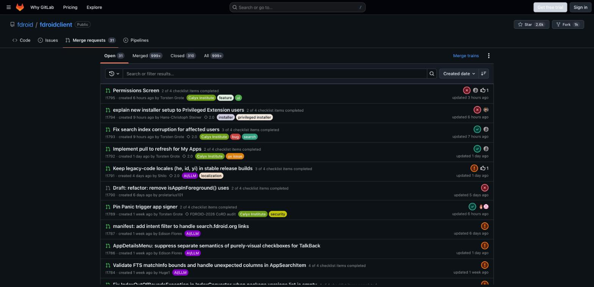
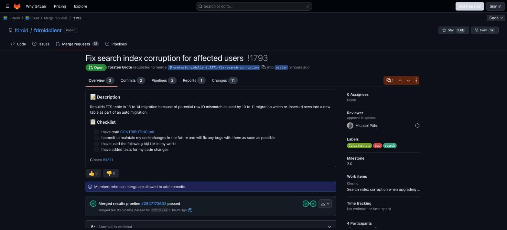
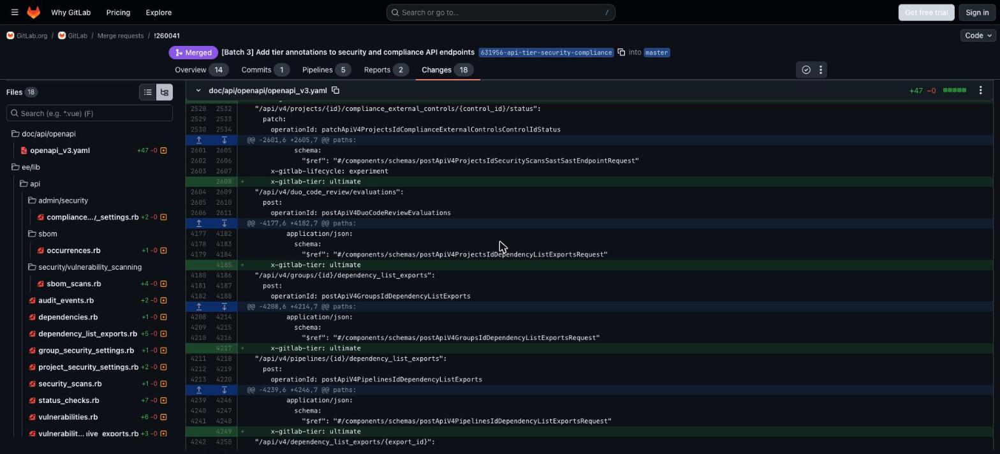

<p align="center">
  
</p>

<h1 align="center">LabHub</h1>

<p align="center">
  <b>GitLab that looks and feels like GitHub, and never shows you stale status.</b><br>
  A Chrome extension for gitlab.com and self-hosted GitLab.
</p>

<p align="center">
  <a href="https://github.com/myselfshravan/LabHub/actions/workflows/ci.yml"></a>
  <a href="https://github.com/myselfshravan/LabHub/releases/latest"></a>
  <a href="LICENSE"></a>
</p>

**Merge request list**: GitHub repo header and tabs, state icons, one bordered list



**Merge request**: big title with `!number`, state pill, GitHub tab counters, bordered description



**Diff**: GitHub's dark diff colors, blue hunk headers, syntax colors and diffstat squares



<sub>gitlab.com in dark mode with LabHub on.</sub>

> [!NOTE]
> **Built end to end in a single Claude Code session.** Every line of code, the tests, the
> CI, the screenshots and this README came out of one conversation with Claude.

## Install

1. Download `labhub-<version>-chrome.zip` from the [latest release](https://github.com/myselfshravan/LabHub/releases/latest) and unzip it.
2. Open `chrome://extensions`, turn on **Developer mode**, click **Load unpacked**, pick the unzipped folder.
3. Open any GitLab page. Use the toolbar icon to toggle features; there's a master on/off switch.

Self-hosted GitLab: open your instance, click the LabHub icon, then **Enable on &lt;host&gt;**.
Chrome asks for permission for that one origin only.

## What it does

### Keep pages fresh (`freshness`)

GitLab renders most of a page once; come back to a tab later and the MR status, pipeline,
approvals or list you're looking at may be out of date. LabHub takes a cheap API
"fingerprint" of what the page shows and re-checks it:

| When                                    | What happens on a change                                                     |
| --------------------------------------- | ---------------------------------------------------------------------------- |
| The tab is in the background (each min) | Refreshes right away, so it's already fresh when you switch back             |
| You're on the tab (checked every 30 s)  | Refreshes in place once you pause for a few seconds; scroll position is kept |
| You return to the tab, or come online   | Refreshes immediately                                                        |
| A refresh would lose something          | Waits, and shows a small "This page has updates" bar until it's safe         |

"Nothing would be lost" means: no typed text in a comment box or field, no focused input,
no open editor/dialog, no text selection. Scroll position is restored after a reload.

What's watched:

| Page                            | Change detected                                                                           |
| ------------------------------- | ----------------------------------------------------------------------------------------- |
| MR                              | new commits, pipeline status / new pipeline, comments, approvals, state, draft, conflicts |
| Issue / work item               | state, comments, any update                                                               |
| Project MR / issue list         | any row on screen updated, or a new item matching your filters                            |
| Group / dashboard list          | the same rows in the page's own sort order                                                |
| To-Do list                      | pending to-dos                                                                            |
| Pipeline, job, pipeline list    | nothing to do: GitLab live-updates these itself; only the tab title is kept current       |
| Anything else (code, settings…) | no detection; reloads on return after 5 minutes away                                      |

MR, pipeline and job tabs show the CI status in the tab title (✅ ❌ 🔄 ⏳ ⚠️), refreshed once a
minute while the tab is in the background, so you can watch a pipeline from another tab.

### GitHub look (`github-theme`)

GitLab, colored and shaped like GitHub (tuned for dark mode, works in light):

- GitLab's whole color palette swapped for GitHub's Primer palette, so every GitLab component
  (including ones not styled by hand) comes out in GitHub colors
- green primary buttons, 6px corners, coral tab underline, pill labels, counters
- MR/issue lists as one bordered box, bold titles, muted meta line
- big Open / Merged / Closed state pills, large "Title !123" headers
- GitHub diff colors (classic and Rapid Diffs), comment cards, markdown rhythm, round avatars

### GitHub layout (`github-layout`)

- No permanent left sidebar: ☰ in the top bar (GitHub's spot) brings GitLab's sidebar back,
  docked beside the page, and remembers the choice
- Repo header on project pages: `owner / repo`, visibility, Star and Fork counts, and the
  **Code · Issues · Merge requests · Pipelines** tab bar with open counts
- GitHub's green / purple / red / grey state icons in front of every MR and issue in lists

### Short tab titles (`tab-titles`)

Tabs lead with the repo name instead of burying it at the end:

| GitLab's title                                                 | LabHub                 |
| -------------------------------------------------------------- | ---------------------- |
| Merge requests · Acme / experiments / web-app · GitLab         | web-app · MRs (3)      |
| Fix login (!12) · Merge requests · Acme / … / web-app · GitLab | web-app !12 Fix login  |
| Pipeline #99 · Acme / … / web-app · GitLab                     | web-app · Pipeline #99 |
| README.md · main · Acme / … / web-app · GitLab                 | web-app · README.md    |

Combined with freshness it reads e.g. `✅ web-app !12 Fix login`.

### ⌘K / Ctrl+K (`command-palette`)

Opens GitLab's "Search or go to…" palette (supports `>` commands, `@` users, `:` projects).
Ignored inside editors, where GitLab uses ⌘K to insert a link.

GitLab already has the other GitHub shortcuts natively, so they aren't duplicated: `t` file
finder, `y` permalink, `?` shortcut list, `[`/`]` previous/next file and the **Viewed** checkbox in MR diffs.

Every feature can be toggled from the toolbar popup, and there's a master on/off switch.
Settings → intervals, background refresh vs banner-only, self-hosted instances, logs.

## Build from source

```sh
npm install
npm run build          # → .output/chrome-mv3
```

Chrome → `chrome://extensions` → enable **Developer mode** → **Load unpacked** →
select `.output/chrome-mv3`. After a rebuild, hit the reload icon on the extension card.

For development, `npm run dev` builds `.output/chrome-mv3-dev`; load that folder instead and it
hot-reloads on every change (keep `npm run dev` running). Don't load both at once.

Releases are cut by pushing a `v*` tag: CI builds the zip and attaches it to a GitHub release.

## Development

```sh
npm run check    # lint + typecheck + tests
npm test         # vitest (happy-dom)
```

```
src/
  core/        settings, logger + log store, page detection, API client, feature registry, hosts
  features/    one folder per feature (index.ts = defineFeature, plus its modules and tests)
  entrypoints/ content script, background worker, popup, options
```

A feature is `defineFeature({ id, title, description, defaultOn, matches?, css?, settingsKey?, init })`.
`init` gets `{ page, settings, api, log, signal, onCleanup }`; the registry starts it on matching
pages and tears it down on navigation, toggle-off or relevant settings changes. Register new
features in `src/features/index.ts`.

### Logs

Everything logs as `[BGL:<namespace>]` in the page console (debug level only when **Debug
logging** is on). All levels are buffered (last 1000) and viewable/exportable in Settings → Logs.

## How it talks to GitLab

Read-only `GET /api/v4/...` from the page's own origin with your existing session cookie —
no tokens, nothing leaves your browser.

## Privacy

LabHub has no server and no analytics. It only reads from the GitLab instance you are already
signed in to, with your own browser session, and stores its settings in Chrome sync storage.

## License

[MIT](LICENSE)
